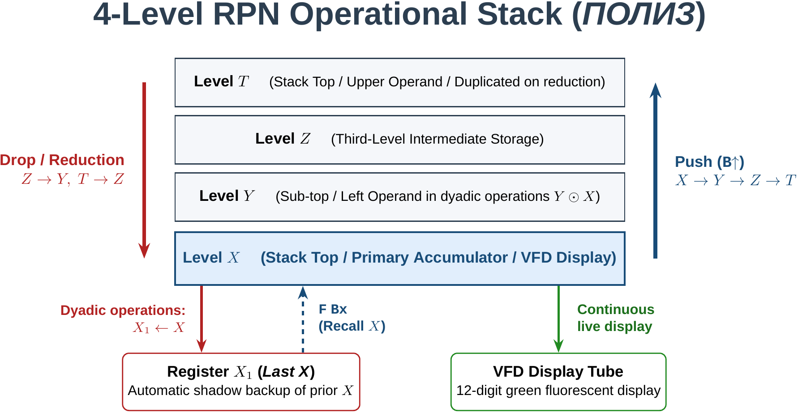
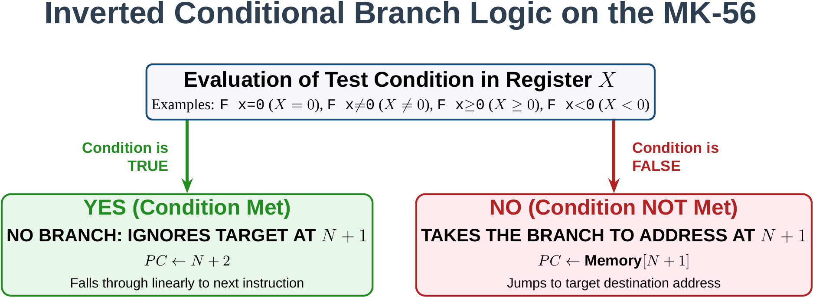
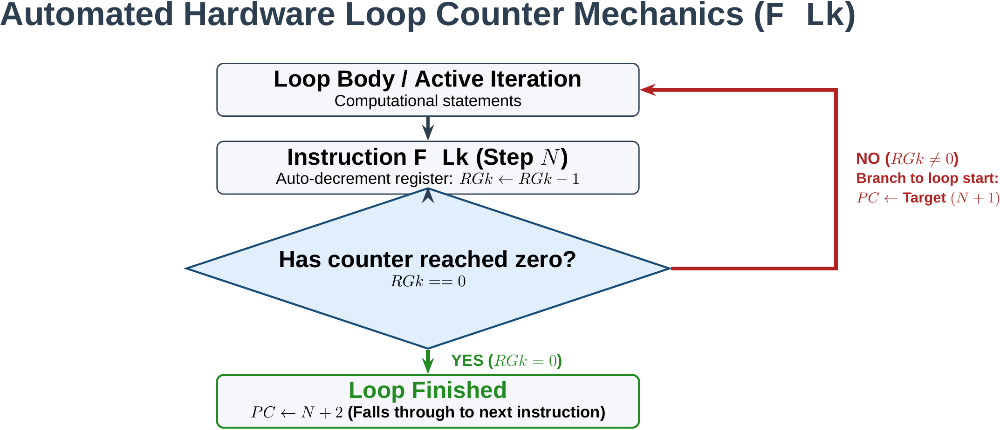
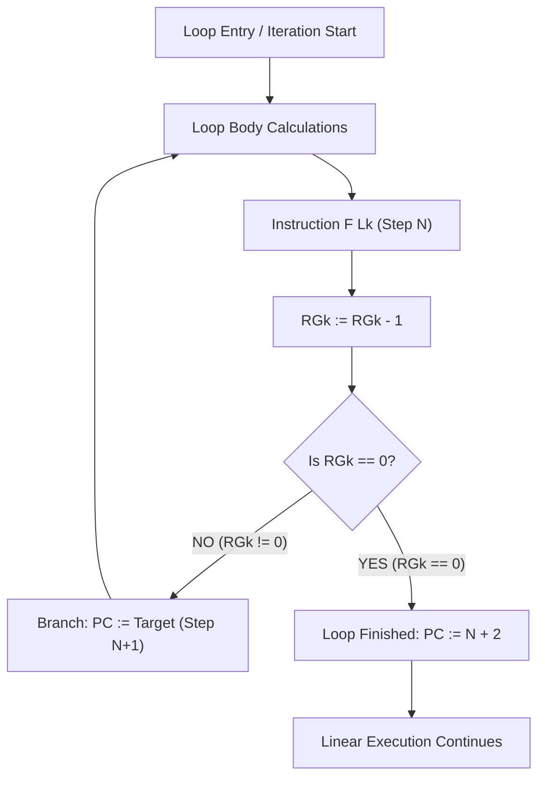

# Elektronika MK-56: Technical Reference Manual

Technical documentation and architectural specification for the Soviet microprogrammable calculator **Elektronika MK-56** (*Электроника МК-56*). Designed as an authoritative normative reference for formal specification, retrocomputing emulators, virtual machines, assemblers, and compiler development.

---

## 1. Architecture and Stack

### 1.1. Historical Context and Core Circuitry
The **Elektronika MK-56** (*Электроника МК-56*) is the desktop mains-powered variant ($220\text{V AC}, 50\text{ Hz}$) of the second-generation programmable calculator family manufactured in the USSR. It shares microarchitecture, binary instruction set encoding, execution timing, and cycle dynamics with the handheld models **Elektronika B3-34** (*Электроника Б3-34*) and **Elektronika MK-54** (*Электроника МК-54*).

The computational core is constructed around high-density PMOS LSI integrated circuits from the **K145 series** (*серия К145*):
- **D4 (К145ИК1302 / K145IK1302)**: Main control microcomputer, sequencer, and keyboard decoder. Manages instruction fetch-decode-execute cycles, keypad scanning, VFD refresh routines, and program counter (PC) addressing.
- **D5 (К145ИК1303 / K145IK1303)**: Arithmetic and transcendent function coprocessor. Implements CORDIC micro-algorithms and series expansions for trigonometric, logarithmic, and exponential operations.
- **D6 and D7 (К145ИР2 / K145IR2)**: Dynamic 1008-bit serial shift-register delay lines providing circular storage for the 14 addressable data registers, the 4 operational stack levels, and the subroutine return stack.
- **D8 (К145АП1 / K145AP1)**: Multi-phase clock generator and dynamic timing pulse driver for the PMOS circuitry.
- **D1, D2, D3 (К161ПП1 / К161КН1 / K161 series)**: High-voltage driver ICs switching phosphor anodes and grid control lines for the vacuum fluorescent display.

### 1.2. Numeric Format and Vacuum Fluorescent Display (VFD)
The calculator is equipped with a green-teal 12-digit vacuum fluorescent display (VFD / *вакуумно-люминесцентный индикатор*):
- **Mantissa**: 8 decimal significant digits plus 1 sign position.
- **Exponent**: 2 decimal digits plus 1 exponent sign position.
- **Dynamic Representation Range**:
  $$\pm 1 \times 10^{-99} \le |x| \le 9.9999999 \times 10^{99}$$
- **Fixed-Point vs. Scientific Display Modes**:
  - Values within $[10^{-7}, 10^8 - 1]$ automatically display in standard fixed-point decimal notation with the decimal point located at the corresponding place value.
  - Values outside this range, or upon manual entry via the `ВП` key (*Ввод Порядка* - Enter Exponent), transition to scientific floating-point notation:
    $$\pm M.MMMMMMM \quad \pm EE$$
- **Error Conditions and Overflow**:
  - Arithmetic singularities (division by zero, square root of negative values, non-positive logarithms) or exponent overflow ($> +99$) cause the sequencer to halt automatic execution and display `ЕГГОГ` (a 7-segment representation of *ERROR* using Soviet segment glyphs).

### 1.3. RPN Stack Architecture (ПОЛИЗ)
The processor executes expressions using Reverse Polish Notation (in Soviet computer science: *ПОЛИЗ - Польская Инверсная Запись* / Polish Inverted Notation). Evaluation requires no deferred execution parentheses; instead, it utilizes a **4-level hardware operational stack** ($X, Y, Z, T$) coupled with an automatic **shadow backup register** ($X_1$):



```
        ┌────────────────────────────────────────────────────────┐
        │                 Operational Stack (RPN)                │
        ├─────────┬──────────────────────────────────────────────┤
        │ Level T │ Register T (Stack Top / Upper operand)       │
        │ Level Z │ Register Z (Third level storage)             │
        │ Level Y │ Register Y (Sub-top / Left operand)          │
        │ Level X │ Register X (Stack Top / Display / Accumulator│
        └─────────┴──────────────────────────────────────────────┘
                                ▲             │
                                │ F Bx        │ Dyadic operation
                                │             ▼
                          ┌────────────┐┌────────────┐
                          │Register X1 ││ VFD Display│
                          │ (Last X)   │└────────────┘
                          └────────────┘
```

#### Stack Register Definitions:
1. **Register X** (`Регистр X`): Stack top (*Вершина стека*). This is the only register continuously reflected on the VFD. It serves as the primary accumulator for all monadic operations and the target for dyadic results.
2. **Register Y** (`Регистр Y`): Sub-top. Holds the left operand (first operand) in binary operations: $Y \odot X$.
3. **Register Z** (`Регистр Z`): Third-level intermediate storage.
4. **Register T** (`Регистр T`): Fourth level of the stack.
5. **Register X1** (`Регистр X1 / Предыдущий результат`): Shadow backup register (*Last X*). Automatically captures the previous contents of $X$ immediately prior to executing any binary arithmetic operation or transcendent function. Restorable into $X$ using the key sequence `F` `Bx` (*Восстановление X*).

### 1.4. Stack State Dynamics and Transition Matrices

#### A. Data Entry and Duplication: `В↑` (*Ввод в стек* / Enter / Push)
Pressing `В↑` pushes all stack levels upward:
- $X \to Y$
- $Y \to Z$
- $Z \to T$
- The previous value of $T$ is dropped.
- The value in $X$ is preserved (duplicated across $X$ and $Y$), preparing $X$ to receive new digits without overwriting $Y$.

$$\begin{pmatrix} X \\ Y \\ Z \\ T \end{pmatrix} \xrightarrow{\mathbf{B\uparrow}} \begin{pmatrix} X \\ X \\ Y \\ Z \end{pmatrix}$$

#### B. Operand Swap: `↔` (*Обмен X и Y* / Swap)
Exchanges the contents of the stack top ($X$) and sub-top ($Y$) without altering $Z$ and $T$:

$$\begin{pmatrix} X \\ Y \\ Z \\ T \end{pmatrix} \xrightarrow{\mathbf{\leftrightarrow}} \begin{pmatrix} Y \\ X \\ Z \\ T \end{pmatrix}$$

#### C. Downward Circular Rotation: `F` `↻` (*Кольцевое перемещение* / Roll Down)
Cyclically rotates the four stack levels downward:
- $Y \to X$
- $Z \to Y$
- $T \to Z$
- $X \to T$

$$\begin{pmatrix} X \\ Y \\ Z \\ T \end{pmatrix} \xrightarrow{\mathbf{F\ \circlearrowright}} \begin{pmatrix} Y \\ Z \\ T \\ X \end{pmatrix}$$
*Note*: Performing four consecutive `F ↻` operations restores the stack precisely to its initial state.

#### D. Clear Accumulator: `Сх` (*Сброс X* / Clear X)
Clears the active mantissa in $X$ to zero without modifying depth or data in $Y$, $Z$, and $T$:

$$\begin{pmatrix} X \\ Y \\ Z \\ T \end{pmatrix} \xrightarrow{\mathbf{Cx}} \begin{pmatrix} 0 \\ Y \\ Z \\ T \end{pmatrix}$$

#### E. Dyadic Arithmetic Reduction ($+$, $-$, $\times$, $\div$)
In binary operations where $Y$ is the left-hand operand and $X$ is the right-hand operand ($Y \odot X$):
1. The right operand $X$ is stored into the shadow backup register $X_1$ ($X_1 \leftarrow X$).
2. The evaluated result $Y \odot X$ is written to $X$.
3. Level $Z$ drops to $Y$ ($Z \to Y$).
4. Level $T$ drops to $Z$ ($T \to Z$).
5. Level $T$ **duplicates its value** ($T \to T$), a distinctive characteristic of PMOS RPN hardware architectures.

$$\begin{pmatrix} X \\ Y \\ Z \\ T \end{pmatrix} \xrightarrow{\mathbf{+,\ -,\ \times,\ \div}} \begin{pmatrix} Y \odot X \\ Z \\ T \\ T \end{pmatrix}, \quad X_1 \leftarrow X$$

#### F. Hardware Subroutine Return Stack (*Стек возврата*)
The K145IK1302 core integrates a **dedicated 5-level LIFO hardware return stack**:
- Each subroutine call (`ПП`) pushes the next sequential address ($\text{PC} + 2$) onto the return stack.
- Each subroutine return (`В/О`) pops the top address from the return stack and branches to it.
- **Nesting limit**: Nesting more than 5 levels causes return stack overflow (*circular overwrite*), dropping the oldest return address.

---

## 2. Memory Map and Registers

### 2.1. Program Memory (ОЗУ команд)
- **Total Capacity**: 98 program steps.
- **Address Space**: 2-digit linear decimal addressing from `00` to `97`.
- **Instruction Format**: 1 byte per step. Branch instructions taking immediate addresses span two contiguous steps:
  - Step $N$: Branch opcode (e.g., `51` for unconditional jump `БП`).
  - Step $N+1$: 2-digit decimal target address (e.g., `42`).

#### Operating Modes:
1. **Automatic / Run Mode** (`АВТ` / `F ABT` or `Р` [*Работа*] switch):
   Executes program steps sequentially at full clock speed upon pressing `С/П` (*Старт/Пуск*).
2. **Programming / Edit Mode** (`ПРГ` / `F ПРГ` or `ПРГ` [*Программирование*] switch):
   Allows direct reading and writing of program RAM. The VFD adopts the canonical format:
   $$\mathbf{AA \quad CC}$$
   Where:
   - $\mathbf{AA}$ = Current program counter address (`00` to `97`).
   - $\mathbf{CC}$ = Opcode byte stored at that address.
   - Key `ШГ` $\rightarrow$ (*Шаг вперед* - Step forward): Advances PC by 1 step.
   - Key `ШГ` $\leftarrow$ (*Шаг назад* - Step backward): Decrements PC by 1 step.

### 2.2. Addressable Data Registers (Адресуемые регистры)
The MK-56 features **14 non-volatile static/dynamic data registers** while powered:
$$RG0, RG1, RG2, RG3, RG4, RG5, RG6, RG7, RG8, RG9, RGa, RGb, RGc, RGd$$

Each register stores a full floating-point decimal word (8-digit mantisa and 2-digit signed exponent).

```
   ┌────────────────────────────────────────────────────────┐
   │             14 Addressable Data Registers              │
   ├──────────┬──────────────┬──────────────────────────────┤
   │ Register │ Key Assigned │ Behavior in Indirect Mode (K)│
   ├──────────┼──────────────┼──────────────────────────────┤
   │ RG0      │ 0            │ Auto-decrement by 1 (R0 - 1) │
   │ RG1      │ 1            │ Auto-decrement by 1 (R1 - 1) │
   │ RG2      │ 2            │ Auto-decrement by 1 (R2 - 1) │
   │ RG3      │ 3            │ Auto-decrement by 1 (R3 - 1) │
   ├──────────┼──────────────┼──────────────────────────────┤
   │ RG4      │ 4            │ Auto-increment by 1 (R4 + 1) │
   │ RG5      │ 5            │ Auto-increment by 1 (R5 + 1) │
   │ RG6      │ 6            │ Auto-increment by 1 (R6 + 1) │
   ├──────────┼──────────────┼──────────────────────────────┤
   │ RG7      │ 7            │ No auto-modification (R7)    │
   │ RG8      │ 8            │ No auto-modification (R8)    │
   │ RG9      │ 9            │ No auto-modification (R9)    │
   │ RGa      │ . (a)        │ No auto-modification (Ra)    │
   │ RGb      │ /-/ (b)      │ No auto-modification (Rb)    │
   │ RGc      │ ВП (c)       │ No auto-modification (Rc)    │
   │ RGd      │ Сх (d)       │ No auto-modification (Rd)    │
   └──────────┴──────────────┴──────────────────────────────┘
```

### 2.3. Memory Addressing Modes

#### 1. Direct Addressing:
- **Store into Register**: `x→П [R]` (*Запись X в регистр*). Copies accumulator $X$ into register $R$ ($0 \le R \le d$). $X$ is preserved.
- **Recall from Register**: `П→x [R]` (*Вызов из регистра в X*). Pushes the operational stack upward and loads register $R$ into $X$.

#### 2. Indirect Addressing (Prefix `K`):
- **Indirect Store**: `K` `x→П [R]`. Uses the integer portion of register $R$ as the effective target pointer to store $X$.
- **Indirect Recall**: `K` `П→x [R]`. Uses the integer portion of register $R$ as the source pointer to load data into $X$.

#### Automatic Pointer Modification Rule:
Prior to completing the data transfer or indirect branch:
- If $R \in \{0, 1, 2, 3\}$: Pointer register $R$ is **decremented by 1** ($R \leftarrow R - 1$).
- If $R \in \{4, 5, 6\}$: Pointer register $R$ is **incremented by 1** ($R \leftarrow R + 1$).
- If $R \in \{7, 8, 9, a, b, c, d\}$: Pointer register $R$ remains **unmodified**.

---

## 3. Instruction Set Architecture (Opcodes)

The table below compiles the complete instruction set of the Elektronika MK-56 transcribed from the factory manual (**Table 4 - Таблица 4**).

### Pseudo-Hexadecimal VFD Display Conventions
The K145IK1302 microcontroller encodes 4-bit nibbles (`0x0` to `0xF`) on 7-segment displays according to Soviet design standards:
- `0` to `9` $\to$ Standard decimal digits `0` to `9`
- `0xA` (10) $\to$ `-` (middle horizontal segment)
- `0xB` (11) $\to$ `L` (lower vertical and bottom horizontal segments)
- `0xC` (12) $\to$ `C` (top, upper/lower left, and bottom segments)
- `0xD` (13) $\to$ `Г` (Cyrillic Gamma: top and upper left segments)
- `0xE` (14) $\to$ `E` (standard capital E)
- `0xF` (15) $\to$ *Blank space* (all segments unlit)

---

### Physical Keyboard Layout


### Official Instruction Set Table (Таблица 4)

| Key (Cyrillic) | English Designation | VFD Opcode | Hex Eq. | Technical Description & Stack Semantics |
| :--- | :--- | :---: | :---: | :--- |
| **0** | Zero | `00` | `0x00` | Loads literal digit 0 into accumulator $X$ |
| **1** | One | `01` | `0x01` | Loads literal digit 1 into accumulator $X$ |
| **2** | Two | `02` | `0x02` | Loads literal digit 2 into accumulator $X$ |
| **3** | Three | `03` | `0x03` | Loads literal digit 3 into accumulator $X$ |
| **4** | Four | `04` | `0x04` | Loads literal digit 4 into accumulator $X$ |
| **5** | Five | `05` | `0x05` | Loads literal digit 5 into accumulator $X$ |
| **6** | Six | `06` | `0x06` | Loads literal digit 6 into accumulator $X$ |
| **7** | Seven | `07` | `0x07` | Loads literal digit 7 into accumulator $X$ |
| **8** | Eight | `08` | `0x08` | Loads literal digit 8 into accumulator $X$ |
| **9** | Nine | `09` | `0x09` | Loads literal digit 9 into accumulator $X$ |
| **.** | Decimal Point | `0-` | `0x0A` | Decimal point separator for active mantissa |
| **/-/** | Change Sign | `0L` | `0x0B` | Inverts sign of accumulator ($X \leftarrow -X$) |
| **ВП** | Enter Exponent | `0C` | `0x0C` | Switches to scientific exponent entry ($EE$) |
| **Сх** | Clear X | `0Г` | `0x0D` | Clears active accumulator ($X \leftarrow 0$); stack unchanged |
| **В↑** | Enter / Push | `0E` | `0x0E` | Push: $X \to Y, Y \to Z, Z \to T$; preserves $X$ |
| **+** | Addition | `10` | `0x10` | $X \leftarrow Y + X$; $Z \to Y$; $T \to Z$; $X_1 \leftarrow X$ |
| **-** | Subtraction | `11` | `0x11` | $X \leftarrow Y - X$; $Z \to Y$; $T \to Z$; $X_1 \leftarrow X$ |
| **x** | Multiplication | `12` | `0x12` | $X \leftarrow Y \times X$; $Z \to Y$; $T \to Z$; $X_1 \leftarrow X$ |
| **÷** | Division | `13` | `0x13` | $X \leftarrow Y / X$; $Z \to Y$; $T \to Z$; $X_1 \leftarrow X$ ($X \ne 0$) |
| **↔** | Swap X and Y | `14` | `0x14` | Swap: $X \leftrightarrow Y$; levels $Z$ and $T$ unaffected |
| **F 10^x** | Ten to the Power of X | `15` | `0x15` | $X \leftarrow 10^X$; $X_1 \leftarrow X$ |
| **F e^x** | Exponential | `16` | `0x16` | $X \leftarrow e^X$; $X_1 \leftarrow X$ |
| **F lg** | Common Log (Base 10) | `17` | `0x17` | $X \leftarrow \log_{10}(X)$; $X_1 \leftarrow X$ ($X > 0$) |
| **F ln** | Natural Log (Base e) | `18` | `0x18` | $X \leftarrow \ln(X)$; $X_1 \leftarrow X$ ($X > 0$) |
| **F sin^-1** | Arc Sine | `19` | `0x19` | $X \leftarrow \arcsin(X)$; $X_1 \leftarrow X$ ($|X| \le 1$) |
| **F cos^-1** | Arc Cosine | `1-` | `0x1A` | $X \leftarrow \arccos(X)$; $X_1 \leftarrow X$ ($|X| \le 1$) |
| **F tg^-1** | Arc Tangent | `1L` | `0x1B` | $X \leftarrow \arctan(X)$; $X_1 \leftarrow X$ |
| **F sin** | Sine | `1C` | `0x1C` | $X \leftarrow \sin(X)$; angular mode per toggle switch |
| **F cos** | Cosine | `1Г` | `0x1D` | $X \leftarrow \cos(X)$; angular mode per toggle switch |
| **F tg** | Tangent | `1E` | `0x1E` | $X \leftarrow \tan(X)$; angular mode per toggle switch |
| **F π** | Constant Pi | `20` | `0x20` | Loads $\pi \approx 3.1415926$ into $X$; pushes stack |
| **F √** | Square Root | `21` | `0x21` | $X \leftarrow \sqrt{X}$; $X_1 \leftarrow X$ ($X \ge 0$) |
| **F x^2** | Square | `22` | `0x22` | $X \leftarrow X^2$; $X_1 \leftarrow X$ |
| **F 1/x** | Reciprocal | `23` | `0x23` | $X \leftarrow 1/X$; $X_1 \leftarrow X$ ($X \ne 0$) |
| **F x^y** | Arbitrary Power | `24` | `0x24` | $X \leftarrow Y^X$; $Z \to Y$; $T \to Z$; $X_1 \leftarrow X$ |
| **x→П 0** | Store to RG0 | `40` | `0x40` | $RG0 \leftarrow X$; accumulator $X$ preserved |
| **x→П 1** | Store to RG1 | `41` | `0x41` | $RG1 \leftarrow X$; accumulator $X$ preserved |
| **x→П 2** | Store to RG2 | `42` | `0x42` | $RG2 \leftarrow X$; accumulator $X$ preserved |
| **x→П 3** | Store to RG3 | `43` | `0x43` | $RG3 \leftarrow X$; accumulator $X$ preserved |
| **x→П 4** | Store to RG4 | `44` | `0x44` | $RG4 \leftarrow X$; accumulator $X$ preserved |
| **x→П 5** | Store to RG5 | `45` | `0x45` | $RG5 \leftarrow X$; accumulator $X$ preserved |
| **x→П 6** | Store to RG6 | `46` | `0x46` | $RG6 \leftarrow X$; accumulator $X$ preserved |
| **x→П 7** | Store to RG7 | `47` | `0x47` | $RG7 \leftarrow X$; accumulator $X$ preserved |
| **x→П 8** | Store to RG8 | `48` | `0x48` | $RG8 \leftarrow X$; accumulator $X$ preserved |
| **x→П 9** | Store to RG9 | `49` | `0x49` | $RG9 \leftarrow X$; accumulator $X$ preserved |
| **x→П a** | Store to RGa | `4-` | `0x4A` | $RGa \leftarrow X$; accumulator $X$ preserved |
| **x→П b** | Store to RGb | `4L` | `0x4B` | $RGb \leftarrow X$; accumulator $X$ preserved |
| **x→П c** | Store to RGc | `4C` | `0x4C` | $RGc \leftarrow X$; accumulator $X$ preserved |
| **x→П d** | Store to RGd | `4Г` | `0x4D` | $RGd \leftarrow X$; accumulator $X$ preserved |
| **С/П** | Start / Stop | `50` | `0x50` | Halts or initiates automatic execution |
| **БП** | Unconditional Branch | `51` | `0x51` | Direct jump: $\text{PC} \leftarrow \text{immediate byte } (N+1)$ |
| **В/О** | Return / Reset | `52` | `0x52` | Return from subroutine (pop stack) or $\text{PC} \leftarrow 00$ |
| **ПП** | Call Subroutine | `53` | `0x53` | Push $\text{PC}+2$ to return stack; $\text{PC} \leftarrow \text{byte } (N+1)$ |
| **K НОП** | No Operation (NOP) | `54` | `0x54` | No Operation; advances $\text{PC} \leftarrow \text{PC}+1$ |
| **F x≠0** | Branch if $X \ne 0$ | `57` | `0x57` | **Inverted:** If $X = 0 \implies$ jump to $N+1$; If $X \ne 0 \implies \text{PC}+2$ |
| **F L2** | Loop Counter RG2 | `58` | `0x58` | $RG2 \leftarrow RG2-1$; If $RG2 \ne 0 \implies$ jump; If 0 $\implies \text{PC}+2$ |
| **F x≥0** | Branch if $X \ge 0$ | `59` | `0x59` | **Inverted:** If $X < 0 \implies$ jump to $N+1$; If $X \ge 0 \implies \text{PC}+2$ |
| **F L3** | Loop Counter RG3 | `5-` | `0x5A` | $RG3 \leftarrow RG3-1$; If $RG3 \ne 0 \implies$ jump; If 0 $\implies \text{PC}+2$ |
| **F L1** | Loop Counter RG1 | `5L` | `0x5B` | $RG1 \leftarrow RG1-1$; If $RG1 \ne 0 \implies$ jump; If 0 $\implies \text{PC}+2$ |
| **F x<0** | Branch if $X < 0$ | `5C` | `0x5C` | **Inverted:** If $X \ge 0 \implies$ jump to $N+1$; If $X < 0 \implies \text{PC}+2$ |
| **F L0** | Loop Counter RG0 | `5Г` | `0x5D` | $RG0 \leftarrow RG0-1$; If $RG0 \ne 0 \implies$ jump; If 0 $\implies \text{PC}+2$ |
| **F x=0** | Branch if $X = 0$ | `5E` | `0x5E` | **Inverted:** If $X \ne 0 \implies$ jump to $N+1$; If $X = 0 \implies \text{PC}+2$ |
| **П→x 0** | Recall from RG0 | `60` | `0x60` | $X \leftarrow RG0$; pushes operational stack |
| **П→x 1** | Recall from RG1 | `61` | `0x61` | $X \leftarrow RG1$; pushes operational stack |
| **П→x 2** | Recall from RG2 | `62` | `0x62` | $X \leftarrow RG2$; pushes operational stack |
| **П→x 3** | Recall from RG3 | `63` | `0x63` | $X \leftarrow RG3$; pushes operational stack |
| **П→x 4** | Recall from RG4 | `64` | `0x64` | $X \leftarrow RG4$; pushes operational stack |
| **П→x 5** | Recall from RG5 | `65` | `0x65` | $X \leftarrow RG5$; pushes operational stack |
| **П→x 6** | Recall from RG6 | `66` | `0x66` | $X \leftarrow RG6$; pushes operational stack |
| **П→x 7** | Recall from RG7 | `67` | `0x67` | $X \leftarrow RG7$; pushes operational stack |
| **П→x 8** | Recall from RG8 | `68` | `0x68` | $X \leftarrow RG8$; pushes operational stack |
| **П→x 9** | Recall from RG9 | `69` | `0x69` | $X \leftarrow RG9$; pushes operational stack |
| **П→x a** | Recall from RGa | `6-` | `0x6A` | $X \leftarrow RGa$; pushes operational stack |
| **П→x b** | Recall from RGb | `6L` | `0x6B` | $X \leftarrow RGb$; pushes operational stack |
| **П→x c** | Recall from RGc | `6C` | `0x6C` | $X \leftarrow RGc$; pushes operational stack |
| **П→x d** | Recall from RGd | `6Г` | `0x6D` | $X \leftarrow RGd$; pushes operational stack |
| **K x≠0 0..d** | Indirect Branch $X \ne 0$ | `70`–`7Г` | `0x70`–`0x7D` | Test $X \ne 0$ using target pointer from register $R$ |
| **K БП 0..d** | Indirect Unconditional | `80`–`8Г` | `0x80`–`0x8D` | Indirect branch to target address in register $R$ |
| **K x≥0 0..d** | Indirect Branch $X \ge 0$ | `90`–`9Г` | `0x90`–`0x9D` | Test $X \ge 0$ using target pointer from register $R$ |
| **K ПП 0..d** | Indirect Subroutine | `-0`–`-Г` | `0xA0`–`0xAD` | Indirect call to address stored in register $R$ |
| **K x→П 0..d** | Indirect Store | `L0`–`LГ` | `0xB0`–`0xBD` | Stores $X$ into register pointed by register $R$ |
| **K x<0 0..d** | Indirect Branch $X < 0$ | `C0`–`CГ` | `0xC0`–`0xCD` | Test $X < 0$ using target pointer from register $R$ |
| **K П→x 0..d** | Indirect Recall | `Г0`–`ГГ` | `0xD0`–`0xDD` | Recalls data into $X$ from register pointed by $R$ |
| **K x=0 0..d** | Indirect Branch $X = 0$ | `E0`–`EГ` | `0xE0`–`0xED` | Test $X = 0$ using target pointer from register $R$ |

*Manual Operation Keys (Not Stored in Program Memory)*:
- `F Bx` (Key sequence `F` + `↔`): Recalls the prior operand from shadow register $X_1$ into $X$.
- `F CF` (Key sequence `F` + `Сх`): Cancels active prefix state `F`. Does not emit a bytecode instruction.

---

## 4. Control Flow and Branching

### 4.1. Direct Unconditional Branch: `БП` (*Безусловный переход*)
Encoded across 2 contiguous program memory steps:
- **Step $N$**: `51` (`БП`)
- **Step $N+1$**: Target 2-digit decimal address ($00$ to $97$)
The sequencer assigns the immediate destination to the program counter: $\text{PC} \leftarrow \text{Target}$.

### 4.2. Subroutine Call and Return: `ПП` and `В/О`
- **Subroutine Call (`ПП` - *Переход к подпрограмме*)**:
  - 2-step instruction: Opcode `53` followed by destination address.
  - Operation: Pushes $\text{PC} + 2$ to the 5-level hardware LIFO return stack, then branches: $\text{PC} \leftarrow \text{Address}$.
- **Subroutine Return (`В/О` - *Возврат / Отмена*)**:
  - 1-step instruction: Opcode `52`.
  - Operation: Pops the top address from the hardware return stack and transfers execution there.
  - *Root Level Behavior*: If executed outside a subroutine (return stack empty), `В/О` resets the program counter to zero ($\text{PC} \leftarrow 00$).

### 4.3. Inverted Conditional Branch Mechanics
> [!IMPORTANT]
> **Architectural Quirk of the B3-34 / MK-56 Family**:
> In contrast to standard computing architectures (e.g., x86 or ARM) where a jump occurs when a condition is met (`JZ`, `BEQ`), on the Elektronika MK-56:
> **A BRANCH IS TAKEN ONLY IF THE TEST CONDITION IS FALSE (*условие НЕ выполняется*)**.
> If the test condition evaluates to **TRUE**, the processor **ignores the branch address** at $N+1$ and proceeds sequentially to the next instruction ($\text{PC} \leftarrow N + 2$).



```
                 Is condition in X satisfied?
                              │
               ┌──────────────┴──────────────┐
               ▼                             ▼
        YES (True / Met)              NO (False / Not met)
               │                             │
       Ignores the branch             Takes the branch to
       address at N+1                 the address at N+1
               │                             │
               ▼                             ▼
        PC := N + 2                   PC := Memory[N+1]
```

#### Formal Conditional Branch Specifications:
1. `F x=0` (Opcode `5E`):
   - If $X \ne 0$ (False): **Branches** to address at $N+1$.
   - If $X = 0$ (True): **Does not branch**; advances to $N+2$.
2. `F x≠0` (Opcode `57`):
   - If $X = 0$ (False): **Branches** to address at $N+1$.
   - If $X \ne 0$ (True): **Does not branch**; advances to $N+2$.
3. `F x≥0` (Opcode `59`):
   - If $X < 0$ (False): **Branches** to address at $N+1$.
   - If $X \ge 0$ (True): **Does not branch**; advances to $N+2$.
4. `F x<0` (Opcode `5C`):
   - If $X \ge 0$ (False): **Branches** to address at $N+1$.
   - If $X < 0$ (True): **Does not branch**; advances to $N+2$.

*Compiler Code Generation Pattern for `if (X == 0) { ThenBlock } else { ElseBlock }`*:
```assembly
; At step N:
F x=0           ; Opcode 5E: Jump to label_else IF X != 0 (false)
label_else      ; Address of Else block (step N+1)
; ThenBlock begins here (executes linearly if X == 0)
...
БП              ; Opcode 51: Unconditional jump over Else block
label_end       ; Exit address
label_else:
; ElseBlock begins here (reached via branch if X != 0)
...
label_end:
```

### 4.4. Hardware Loop Counters: `F L0`, `F L1`, `F L2`, `F L3`
Specialized 2-step loop control instructions providing automated decrement and termination tests:
- Opcodes:
  - `F L0` $\to$ `5Г` (bound to register $RG0$)
  - `F L1` $\to$ `5L` (bound to register $RG1$)
  - `F L2` $\to$ `58` (bound to register $RG2$)
  - `F L3` $\to$ `5-` (bound to register $RG3$)
- **Step Structure**:
  - Step $N$: Opcode (`5Г` / `5L` / `58` / `5-`)
  - Step $N+1$: Target loop start address

#### Execution Mechanics:
1. Decrements the integer unit of the designated register:
   $$RGk \leftarrow RGk - 1 \quad (k \in \{0, 1, 2, 3\})$$
2. Evaluates the resulting value:
   - **If $RGk \ne 0$**: The loop continues; jumps to address at $N+1$ ($\text{PC} \leftarrow \text{Target}$).
   - **If $RGk = 0$**: The loop terminates; continues linearly to step $N+2$ ($\text{PC} \leftarrow N + 2$).





### 4.5. Indirect Branching and Dynamic Dispatch
The MK-56 supports indirect unconditional branches, indirect subroutine calls, and indirect conditional tests where the target address is **dynamically loaded from a data register**:
- Consumes **a single program byte** (the address resides inside the register).
- Executes **automatic pointer modification** prior to jumping:
  - Registers $RG0..RG3$: Register is decremented before branching.
  - Registers $RG4..RG6$: Register is incremented before branching.
  - Registers $RG7..RGd$: Register remains unchanged.

#### Types of Indirect Jumps:
1. **Indirect Unconditional Jump**: `K БП [R]` (Opcodes `80` to `8Г`). Modifies $R$ (if $R \le 6$) and branches to the integer address in $R$.
2. **Indirect Subroutine Call**: `K ПП [R]` (Opcodes `-0` to `-Г`). Pushes return address ($\text{PC} + 1$) to return stack, modifies $R$, and branches.
3. **Indirect Conditional Branches**:
   - `K x=0 [R]` (Opcodes `E0` to `EГ`): Evaluates $X$. If $X \ne 0$, modifies $R$ and branches. If $X = 0$, advances to $\text{PC} + 1$ without modifying $R$.
   - `K x≠0 [R]` (Opcodes `70` to `7Г`): Evaluates $X$. If $X = 0$, modifies $R$ and branches. If $X \ne 0$, advances to $\text{PC} + 1$.
   - `K x≥0 [R]` (Opcodes `90` to `9Г`): Evaluates $X$. If $X < 0$, modifies $R$ and branches. If $X \ge 0$, advances to $\text{PC} + 1$.
   - `K x<0 [R]` (Opcodes `C0` to `CГ`): Evaluates $X$. If $X \ge 0$, modifies $R$ and branches. If $X < 0$, advances to $\text{PC} + 1$.

---

## 5. Architectural Specification Summary for Compiler Engineers

| Architectural Parameter | Technical Specification |
| :--- | :--- |
| **Execution Model** | Pure Reverse Polish Notation (RPN) with top-of-stack accumulator |
| **Operational Stack Depth** | 4 hardware levels: $X, Y, Z, T$ |
| **Backup Register** | 1 automatic shadow register: $X_1$ (*Last X*) |
| **Subroutine Call Stack Depth** | 5 dedicated hardware LIFO levels |
| **Code Memory (RAM)** | 98 addressable program steps (`00` to `97`) |
| **Data Registers** | 14 floating-point registers ($RG0..RG9, RGa..RGd$) |
| **Opcode Length** | 1 byte per instruction; immediate branch addresses in subsequent byte |
| **Conditional Branch Logic** | **Inverted:** branches when condition is FALSE; falls through when TRUE |
| **Auto-decrementing Registers** | $RG0, RG1, RG2, RG3$ (decremented by 1 when accessed via `K`) |
| **Auto-incrementing Registers** | $RG4, RG5, RG6$ (incremented by 1 when accessed via `K`) |
| **Hardware Loop Counters** | 4 dedicated instructions: `F L0`, `F L1`, `F L2`, `F L3` |
| **VFD Display Glyphs** | Standard `0..9`; `A` $\to$ `-`, `B` $\to$ `L`, `C` $\to$ `C`, `D` $\to$ `Г`, `E` $\to$ `E`, `F` $\to$ *blank* |

### Practical IR Code Generation Guidelines
When constructing a compiler code generator targeting MK-56 bytecode:
1. **Static Stack Depth Tracking**: The compiler must compute stack depth at each IR node. Because the operational stack is limited to 4 levels, expressions requiring more than 4 concurrent intermediate values must spill temporary registers (typically $RG7..RGd$) using `x→П` and restore them via `П→x`.
2. **Conditional Inversion Mapping**: When emitting conditional jumps:
   $$\text{Emit } \mathtt{F\ x=0} \implies \text{Branch to failure label if } X \ne 0$$
   $$\text{Emit } \mathtt{F\ x\neq0} \implies \text{Branch to failure label if } X = 0$$
   $$\text{Emit } \mathtt{F\ x\ge0} \implies \text{Branch to failure label if } X < 0$$
   $$\text{Emit } \mathtt{F\ x<0} \implies \text{Branch to failure label if } X \ge 0$$
3. **Loop Optimization**: For bounded loops with iteration counts known at runtime in the range $1..99$, allocate the loop counter into one of $RG0..RG3$ and close the loop using `F Lk`, eliminating separate decrement and branch instructions.
