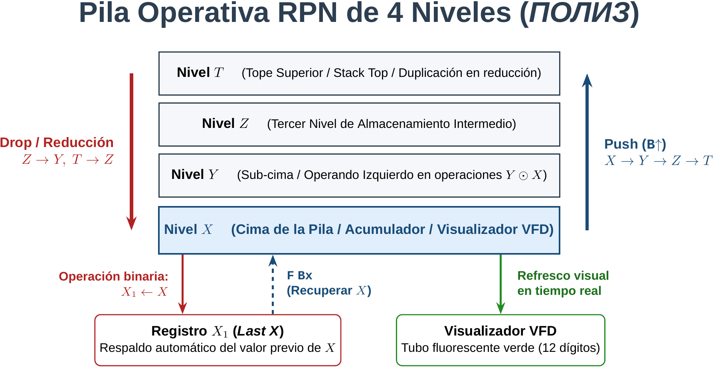
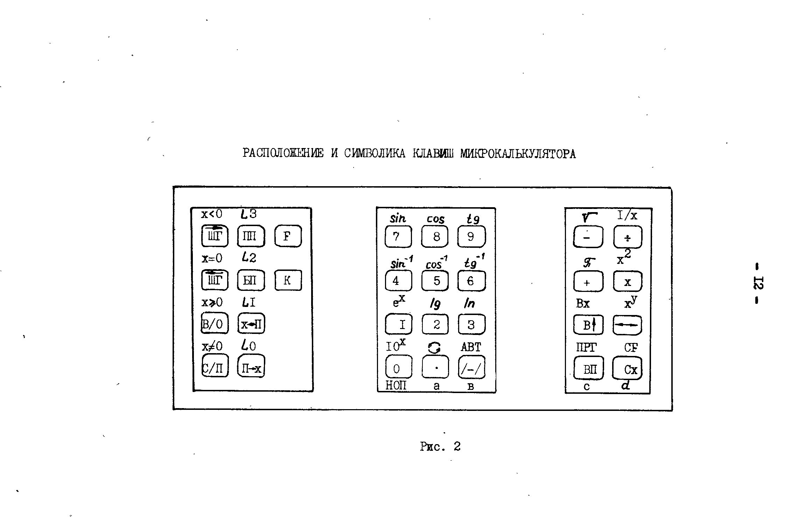
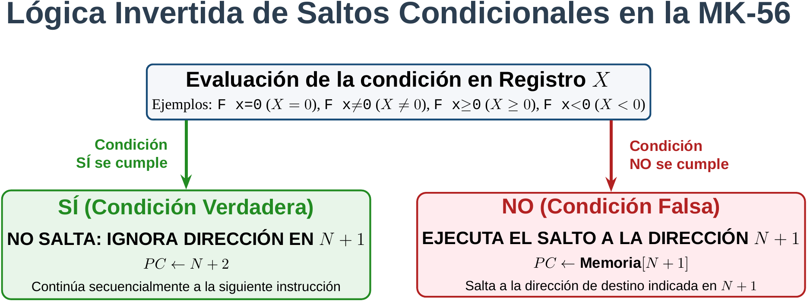
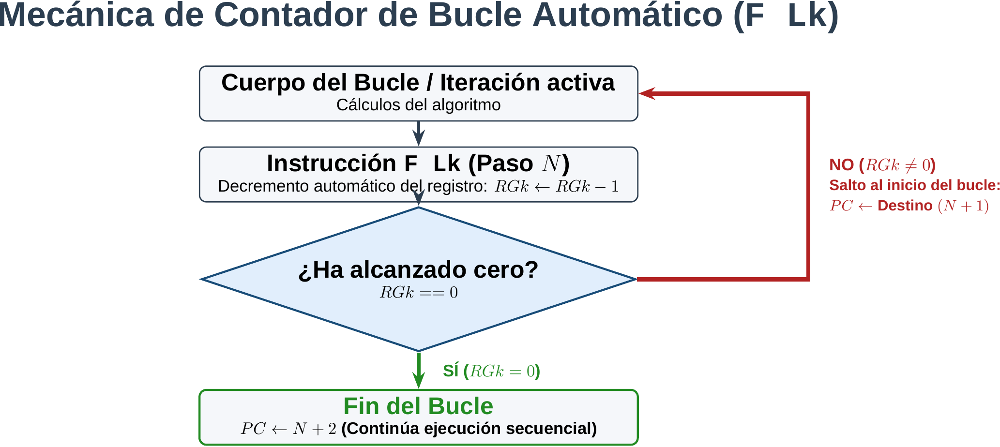
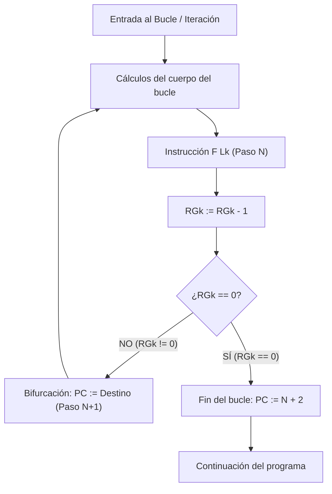

# Elektronika MK-56: Referencia Técnica

Documentación técnica y especificación de arquitectura de la calculadora microprogramable soviética **Elektronika MK-56** (*Электроника МК-56*). Diseñada como documento normativo de referencia para la especificación formal, diseño de compiladores, ensambladores y máquinas virtuales retroinformáticas.

---

## 1. Arquitectura y Pila

### 1.1. Contexto Histórico y Circuitería Base
La calculadora **Elektronika MK-56** (*Электроника МК-56*) es la variante de sobremesa (red eléctrica 220V AC, 50 Hz) de la familia de calculadoras programables de segunda generación de la URSS, compartiendo microarquitectura, juego de instrucciones y compatibilidad de código a nivel binario con los modelos portátiles **Elektronika B3-34** (*Электроника Б3-34*) y **Elektronika MK-54** (*Электроника МК-54*).

El núcleo computacional está basado en la serie de circuitos integrados LSI en tecnología PMOS **K145** (*серия К145*):
- **D4 (К145ИК1302 / K145IK1302)**: Microprocesador de control y secuenciador principal. Interpreta el teclado, procesa el flujo de control, gestiona el refresco del visualizador y coordina las transferencias entre la pila y la memoria.
- **D5 (К145ИК1303 / K145IK1303)**: Unidad de cálculo aritmético y funciones trascendentes (algoritmos CORDIC y desarrollos en serie para funciones trigonométricas y logarítmicas).
- **D6 y D7 (К145ИР2 / K145IR2)**: Memorias de línea de retardo dinámicas / registros de desplazamiento de 1008 bits cada uno, que implementan el almacenamiento para los 14 registros de datos direccionables, los 4 registros de la pila operativa y el registro de la pila de llamadas a subrutinas.
- **D8 (К145АП1 / K145AP1)**: Generador de fases y reloj bifásico de temporización.
- **D1, D2, D3 (К161ПП1 / К161КН1 / K161 series)**: Controladores y llaves de alta tensión para los ánodos y rejillas del tubo indicador fluorescente de vacío.

### 1.2. Formato de Números y Visualización (VFD)
El sistema dispone de un tubo indicador fluorescente de vacío (VFD - *вакуумно-люминесцентный индикатор*) en tono verde de 12 dígitos físicos:
- **Mantisa**: 8 dígitos decimales significativos más signo.
- **Exponente**: 2 dígitos decimales más signo de exponente.
- **Rango dinámico de representación**:
  $$\pm 1 \cdot 10^{-99} \le |x| \le 9{,}9999999 \cdot 10^{99}$$
- **Convención de visualización en punto fijo y punto flotante**:
  - Si el número entra en el rango $[10^{-7}, 10^8 - 1]$, se muestra automáticamente en coma fija con la posición decimal correspondiente.
  - Para magnitudes fuera de dicho rango o tras pulsar la tecla de introducción de orden `ВП` (*Ввод Порядка* - Entrada de Exponente), se conmuta al modo científico:
    $$\pm M{,}MMMMMMM \quad \pm EE$$
- **Condiciones de Error y Sobredesbordamiento**:
  - Al dividir por cero o superar el exponente $+99$, la máquina suspende la ejecución y muestra en pantalla la palabra `ЕГГОГ` (lectura visual humorística de *ERROR* en el juego de segmentos VFD soviético).

### 1.3. Arquitectura de la Pila RPN (ПОЛИЗ)
El procesador opera mediante Notación Polaca Inversa (en la literatura soviética: *ПОЛИЗ - Польская Инверсная Запись* / *Польская запись*). La evaluación de expresiones no utiliza paréntesis de ejecución diferida, sino una pila operativa de 4 niveles ($X, Y, Z, T$) junto con un registro auxiliar para el último resultado intermedio ($X_1$).



```
        ┌────────────────────────────────────────────────────────┐
        │                 Pila Operativa (RPN)                   │
        ├─────────┬──────────────────────────────────────────────┤
        │ Nivel T │ Registro T (Tope superior / Top)             │
        │ Nivel Z │ Registro Z                                   │
        │ Nivel Y │ Registro Y (Sub-cima / Next)                 │
        │ Nivel X │ Registro X (Cima de la pila / Indicador VFD) │
        └─────────┴──────────────────────────────────────────────┘
                               ▲             │
                               │ F Bx        │ Operación diádica
                               │             ▼
                         ┌────────────┐┌────────────┐
                         │ Registro X1││ VFD Pantalla│
                         │ (Prev X)   │└────────────┘
                         └────────────┘
```

#### Registros de la Pila:
1. **Registro X** (`Регистр X`): Cima de la pila operativa (*Вершина стека*). Su contenido es el único visible directamente en la pantalla VFD y actúa como acumulador implícito para todas las operaciones aritméticas y funciones matemáticas unarias.
2. **Registro Y** (`Регистр Y`): Segundo operando para operaciones diádicas ($X$ e $Y$).
3. **Registro Z** (`Регистр Z`): Tercer nivel de almacenamiento temporal.
4. **Registro T** (`Регистр T`): Cuarto nivel de la pila.
5. **Registro X1** (`Регистр X1 / Предыдущий результат`): Registro sombra desacoplado. Guarda de forma automática el valor previo que residía en $X$ inmediatamente antes de ejecutar cualquier operación aritmética o matemática, permitiendo recuperar operandos en cadenas de cálculo complejas mediante la combinación `F` `Bx` (*Восстановление X*).

### 1.4. Dinámica de Transición de Estados de la Pila

#### A. Entrada de datos y duplicación: `В↑` (*Ввод в стек* / Enter)
La tecla física `В↑` empuja el contenido de la pila hacia arriba:
- $X \to Y$
- $Y \to Z$
- $Z \to T$
- El contenido previo de $T$ se descarta.
- El valor de $X$ se preserva inalterado en $X$ (queda duplicado en $X$ e $Y$), preparado para que un nuevo dígito sobreescriba $X$ sin alterar $Y$.

$$\begin{pmatrix} X \\ Y \\ Z \\ T \end{pmatrix} \xrightarrow{\mathbf{B\uparrow}} \begin{pmatrix} X \\ X \\ Y \\ Z \end{pmatrix}$$

#### B. Intercambio de operandos: `↔` (*Обмен X и Y* / Swap)
Intercambia los contenidos de la cima ($X$) y la sub-cima ($Y$), manteniendo intactos $Z$ y $T$:

$$\begin{pmatrix} X \\ Y \\ Z \\ T \end{pmatrix} \xrightarrow{\mathbf{\leftrightarrow}} \begin{pmatrix} Y \\ X \\ Z \\ T \end{pmatrix}$$

#### C. Rotación circular descendente: `F` `↻` (*Кольцевое перемещение*)
Realiza un desplazamiento cíclico descendente de los cuatro registros:
- $Y \to X$
- $Z \to Y$
- $T \to Z$
- $X \to T$

$$\begin{pmatrix} X \\ Y \\ Z \\ T \end{pmatrix} \xrightarrow{\mathbf{F\ \circlearrowright}} \begin{pmatrix} Y \\ Z \\ T \\ X \end{pmatrix}$$
*Nota*: Ejecutar `F ↻` cuatro veces consecutivas restaura la pila a su estado original completo.

#### D. Borrado del registro activo: `Сх` (*Сброс X* / Clear X)
Limpia la pantalla y carga un cero en el registro $X$ sin alterar la profundidad ni el contenido de los registros $Y$, $Z$ y $T$:

$$\begin{pmatrix} X \\ Y \\ Z \\ T \end{pmatrix} \xrightarrow{\mathbf{Cx}} \begin{pmatrix} 0 \\ Y \\ Z \\ T \end{pmatrix}$$

#### E. Reducción de la pila en operaciones diádicas ($+$, $-$, $\times$, $\div$)
Al ejecutar una operación aritmética binaria (donde $Y$ es el operando izquierdo y $X$ el operando derecho):
- El operando $X$ pasa a almacenarse en el registro de respaldo $X_1$.
- El resultado $Y \odot X$ se deposita en $X$.
- El nivel $Z$ cae a $Y$ ($Z \to Y$).
- El nivel $T$ cae a $Z$ ($T \to Z$).
- El registro $T$ **duplica su valor** ($T \to T$), comportamiento característico de las pilas RPN de la era clásica.

$$\begin{pmatrix} X \\ Y \\ Z \\ T \end{pmatrix} \xrightarrow{\mathbf{+,\ -,\ \times,\ \div}} \begin{pmatrix} Y \odot X \\ Z \\ T \\ T \end{pmatrix}, \quad X_1 \leftarrow X$$

#### F. Pila de Retorno de Subrutinas (*Стек возврата*)
El microprocesador K145IK1302 cuenta con una **pila hardware LIFO independiente de 5 niveles** para almacenar las direcciones de retorno tras la ejecución de llamadas a subrutina (`ПП`). 
- Cada llamada `ПП` empuja la dirección de la siguiente instrucción en la pila de retorno.
- Cada retorno `В/О` extrae la dirección superior de la pila de retorno.
- Si se anidan más de 5 llamadas a subrutina, se produce un desbordamiento de la pila de retorno (*Return Stack Overflow*), sobrescribiendo la dirección más antigua.

---

## 2. Mapa de Memoria y Registros

### 2.1. Memoria de Programa (ОЗУ команд)
- **Capacidad**: 98 pasos de programa.
- **Espacio de direcciones**: Direccionamiento lineal de 2 dígitos decimales: `00` a `97`.
- **Formato de instrucción**: Longitud de 1 byte por paso. Las instrucciones con argumento inmediato (saltos absolutos a una dirección) ocupan dos pasos continuos:
  - Paso $N$: Código de operación del salto (ej. `51` para `БП`).
  - Paso $N+1$: Dirección de salto en formato decimal de dos dígitos (ej. `42`).

#### Modos de Trabajo de la Máquina:
1. **Modo Automático / Ejecución** (`АВТ` / `F ABT` o conmutador `Р` [*Работа*]):
   Ejecuta el programa almacenado paso a paso o a velocidad continua tras pulsar `С/П` (*Старт/Пуск*).
2. **Modo Programación** (`ПРГ` / `F ПРГ` o conmutador `ПРГ` [*Программирование*]):
   Permite inspeccionar e introducir instrucciones en la memoria RAM. El visualizador VFD adopta el formato canónico:
   $$\mathbf{AA \quad CC}$$
   Donde:
   - $\mathbf{AA}$ = Dirección de memoria actual (`00` a `97`).
   - $\mathbf{CC}$ = Código de operación (opcode) almacenado en dicha dirección.
   - Tecla `ШГ` $\rightarrow$ (*Шаг вперед*): Avanza una posición de memoria.
   - Tecla `ШГ` $\leftarrow$ (*Шаг назад*): Retrocede una posición de memoria.

### 2.2. Registros de Datos Direccionables (Адресуемые регистры)
La calculadora dispone de **14 registros de memoria no volátiles mientras permanezca encendida**, numerados y etiquetados como:
$$RG0, RG1, RG2, RG3, RG4, RG5, RG6, RG7, RG8, RG9, RGa, RGb, RGc, RGd$$

Cada registro almacena un número decimal completo en formato de coma flotante (mantisa de 8 dígitos y exponente de 2 dígitos con signo).

```
   ┌────────────────────────────────────────────────────────┐
   │        14 Registros de Datos Direccionables            │
   ├──────────┬──────────────┬──────────────────────────────┤
   │ Registro │ Tecla Física │ Propiedad en Direcc. Indirect│
   ├──────────┼──────────────┼──────────────────────────────┤
   │ RG0      │ 0            │ Autodecremento en 1 (R0 - 1) │
   │ RG1      │ 1            │ Autodecremento en 1 (R1 - 1) │
   │ RG2      │ 2            │ Autodecremento en 1 (R2 - 1) │
   │ RG3      │ 3            │ Autodecremento en 1 (R3 - 1) │
   ├──────────┼──────────────┼──────────────────────────────┤
   │ RG4      │ 4            │ Autoincremento en 1 (R4 + 1) │
   │ RG5      │ 5            │ Autoincremento en 1 (R5 + 1) │
   │ RG6      │ 6            │ Autoincremento en 1 (R6 + 1) │
   ├──────────┼──────────────┼──────────────────────────────┤
   │ RG7      │ 7            │ Sin modificación de valor    │
   │ RG8      │ 8            │ Sin modificación de valor    │
   │ RG9      │ 9            │ Sin modificación de valor    │
   │ RGa      │ . (a)        │ Sin modificación de valor    │
   │ RGb      │ /-/ (b)      │ Sin modificación de valor    │
   │ RGc      │ ВП (c)       │ Sin modificación de valor    │
   │ RGd      │ Сх (d)       │ Sin modificación de valor    │
   └──────────┴──────────────┴──────────────────────────────┘
```

### 2.3. Modos de Direccionamiento de Memoria

#### 1. Direccionamiento Directo:
- **Guardar en registro**: `x→П [R]` (*Запись X в регистр*). Copia el valor de $X$ en el registro $R$ ($0 \le R \le d$). $X$ no se altera.
- **Recuperar de registro**: `П→x [R]` (*Вызов из регистра в X*). Copia el contenido del registro $R$ en $X$. Empuja la pila hacia arriba según la dinámica estándar de entrada.

#### 2. Direccionamiento Indirecto (Prefijo `K`):
- **Escritura indirecta**: `K` `x→П [R]` (Opcode de 1 byte). El contenido del registro $R$ se toma como puntero de memoria para escribir el valor de $X$.
- **Lectura indirecta**: `K` `П→x [R]` (Opcode de 1 byte). El contenido del registro $R$ se toma como puntero de memoria para leer el dato y cargarlo en $X$.

#### Regla de Modificación Automática en Direccionamiento Indirecto:
Antes de llevar a cabo la transferencia o el salto indirecto:
- Si $R \in \{0, 1, 2, 3\}$: Se resta $1$ al registro $R$ ($R \leftarrow R - 1$).
- Si $R \in \{4, 5, 6\}$: Se suma $1$ al registro $R$ ($R \leftarrow R + 1$).
- Si $R \in \{7, 8, 9, a, b, c, d\}$: El valor de $R$ permanece invariable.

---

## 3. Repertorio de Instrucciones (Opcodes)

La siguiente tabla recoge la totalidad del repertorio de instrucciones de la Elektronika MK-56 según la especificación oficial del fabricante (**Tabla 4 del manual técnico**). 

### Convención de Codificación Pseudo-Hexadecimal del Visualizador VFD
El circuito integrado K145IK1302 representa los valores hexadecimales `0x0` a `0xF` en el display de 7 segmentos según el estándar soviético:
- `0` a `9` $\to$ Dígitos estándar `0` a `9`
- `0xA` (10) $\to$ `-` (segmento central horizontal)
- `0xB` (11) $\to$ `L` (segmentos vertical inferior e inferior horizontal)
- `0xC` (12) $\to$ `C` (segmentos superior, vertical superior/inferior e inferior)
- `0xD` (13) $\to$ `Г` (letra cirílica Gamma: segmentos superior y vertical izquierdo)
- `0xE` (14) $\to$ `E` (letra E)
- `0xF` (15) $\to$ *Espacio en blanco* (apagado)

---

### Disposición Física del Teclado



### Tabla Oficial de Códigos de Operación (Таблица 4)

| Tecla (Cirílico) | Nombre en Español | Código Opcode | Equivalente Hex | Descripción Técnica / Semántica |
| :--- | :--- | :---: | :---: | :--- |
| **0** | Cero | `00` | `0x00` | Literal numérico 0 en registro $X$ |
| **1** | Uno | `01` | `0x01` | Literal numérico 1 en registro $X$ |
| **2** | Dos | `02` | `0x02` | Literal numérico 2 en registro $X$ |
| **3** | Tres | `03` | `0x03` | Literal numérico 3 en registro $X$ |
| **4** | Cuatro | `04` | `0x04` | Literal numérico 4 en registro $X$ |
| **5** | Cinco | `05` | `0x05` | Literal numérico 5 en registro $X$ |
| **6** | Seis | `06` | `0x06` | Literal numérico 6 en registro $X$ |
| **7** | Siete | `07` | `0x07` | Literal numérico 7 en registro $X$ |
| **8** | Ocho | `08` | `0x08` | Literal numérico 8 en registro $X$ |
| **9** | Nueve | `09` | `0x09` | Literal numérico 9 en registro $X$ |
| **.** | Punto decimal | `0-` | `0x0A` | Separador decimal de la mantisa |
| **/-/** | Cambio de signo | `0L` | `0x0B` | Complemento a la base del signo ($X \leftarrow -X$) |
| **ВП** | Entrada de orden | `0C` | `0x0C` | Conmuta a introducción de exponente ($EE$) |
| **Сх** | Borrar X | `0Г` | `0x0D` | Limpia la mantisa activa en $X$ ($X \leftarrow 0$) |
| **В↑** | Enter / Pila | `0E` | `0x0E` | Push: $X \to Y, Y \to Z, Z \to T$; conserva $X$ |
| **+** | Suma | `10` | `0x10` | $X \leftarrow Y + X$; $Z \to Y$; $T \to Z$; $X_1 \leftarrow X$ |
| **-** | Resta | `11` | `0x11` | $X \leftarrow Y - X$; $Z \to Y$; $T \to Z$; $X_1 \leftarrow X$ |
| **x** | Multiplicación | `12` | `0x12` | $X \leftarrow Y \times X$; $Z \to Y$; $T \to Z$; $X_1 \leftarrow X$ |
| **÷** | División | `13` | `0x13` | $X \leftarrow Y / X$; $Z \to Y$; $T \to Z$; $X_1 \leftarrow X$ |
| **↔** | Intercambio X e Y | `14` | `0x14` | Swap: $X \leftrightarrow Y$; registros $Z$ y $T$ inalterados |
| **F 10^x** | Potencia de 10 | `15` | `0x15` | $X \leftarrow 10^X$; $X_1 \leftarrow X$ |
| **F e^x** | Exponencial | `16` | `0x16` | $X \leftarrow e^X$; $X_1 \leftarrow X$ |
| **F lg** | Logaritmo decimal | `17` | `0x17` | $X \leftarrow \log_{10}(X)$; $X_1 \leftarrow X$ ($X > 0$) |
| **F ln** | Logaritmo natural | `18` | `0x18` | $X \leftarrow \ln(X)$; $X_1 \leftarrow X$ ($X > 0$) |
| **F sin^-1** | Arco seno | `19` | `0x19` | $X \leftarrow \arcsin(X)$; $X_1 \leftarrow X$ ($|X| \le 1$) |
| **F cos^-1** | Arco coseno | `1-` | `0x1A` | $X \leftarrow \arccos(X)$; $X_1 \leftarrow X$ ($|X| \le 1$) |
| **F tg^-1** | Arco tangente | `1L` | `0x1B` | $X \leftarrow \arctan(X)$; $X_1 \leftarrow X$ |
| **F sin** | Seno | `1C` | `0x1C` | $X \leftarrow \sin(X)$; unidad según conmutador angular |
| **F cos** | Coseno | `1Г` | `0x1D` | $X \leftarrow \cos(X)$; unidad según conmutador angular |
| **F tg** | Tangente | `1E` | `0x1E` | $X \leftarrow \tan(X)$; unidad según conmutador angular |
| **F π** | Constante Pi | `20` | `0x20` | Carga $\pi = 3{,}1415926$ en $X$; empuja la pila |
| **F √** | Raíz cuadrada | `21` | `0x21` | $X \leftarrow \sqrt{X}$; $X_1 \leftarrow X$ ($X \ge 0$) |
| **F x^2** | Cuadrado | `22` | `0x22` | $X \leftarrow X^2$; $X_1 \leftarrow X$ |
| **F 1/x** | Inverso | `23` | `0x23` | $X \leftarrow 1/X$; $X_1 \leftarrow X$ ($X \ne 0$) |
| **F x^y** | Potencia arbitraria | `24` | `0x24` | $X \leftarrow Y^X$; $Z \to Y$; $T \to Z$; $X_1 \leftarrow X$ |
| **x→П 0** | Guardar en RG0 | `40` | `0x40` | $RG0 \leftarrow X$ |
| **x→П 1** | Guardar en RG1 | `41` | `0x41` | $RG1 \leftarrow X$ |
| **x→П 2** | Guardar en RG2 | `42` | `0x42` | $RG2 \leftarrow X$ |
| **x→П 3** | Guardar en RG3 | `43` | `0x43` | $RG3 \leftarrow X$ |
| **x→П 4** | Guardar en RG4 | `44` | `0x44` | $RG4 \leftarrow X$ |
| **x→П 5** | Guardar en RG5 | `45` | `0x45` | $RG5 \leftarrow X$ |
| **x→П 6** | Guardar en RG6 | `46` | `0x46` | $RG6 \leftarrow X$ |
| **x→П 7** | Guardar en RG7 | `47` | `0x47` | $RG7 \leftarrow X$ |
| **x→П 8** | Guardar en RG8 | `48` | `0x48` | $RG8 \leftarrow X$ |
| **x→П 9** | Guardar en RG9 | `49` | `0x49` | $RG9 \leftarrow X$ |
| **x→П a** | Guardar en RGa | `4-` | `0x4A` | $RGa \leftarrow X$ |
| **x→П b** | Guardar en RGb | `4L` | `0x4B` | $RGb \leftarrow X$ |
| **x→П c** | Guardar en RGc | `4C` | `0x4C` | $RGc \leftarrow X$ |
| **x→П d** | Guardar en RGd | `4Г` | `0x4D` | $RGd \leftarrow X$ |
| **С/П** | Start / Stop | `50` | `0x50` | Detiene o arranca la ejecución automática |
| **БП** | Salto incondicional | `51` | `0x51` | PC $\leftarrow$ byte inmediato ($N+1$) |
| **В/О** | Retorno / Origen | `52` | `0x52` | Retorno de subrutina (Pop return stack) o PC $\leftarrow 00$ |
| **ПП** | Llamada subrutina | `53` | `0x53` | Push PC+2 a return stack; PC $\leftarrow$ byte inmediato |
| **K НОП** | No Operación (NOP) | `54` | `0x54` | No Operation; avanza PC en 1 paso |
| **F x≠0** | Salto condicional | `57` | `0x57` | Si $X = 0 \implies$ salta a $N+1$; Si $X \ne 0 \implies$ PC+2 |
| **F L2** | Contador bucle RG2 | `58` | `0x58` | $RG2 \leftarrow RG2 - 1$; Si $RG2 \ne 0 \implies$ salta; Si 0 $\implies$ PC+2 |
| **F x≥0** | Salto condicional | `59` | `0x59` | Si $X < 0 \implies$ salta a $N+1$; Si $X \ge 0 \implies$ PC+2 |
| **F L3** | Contador bucle RG3 | `5-` | `0x5A` | $RG3 \leftarrow RG3 - 1$; Si $RG3 \ne 0 \implies$ salta; Si 0 $\implies$ PC+2 |
| **F L1** | Contador bucle RG1 | `5L` | `0x5B` | $RG1 \leftarrow RG1 - 1$; Si $RG1 \ne 0 \implies$ salta; Si 0 $\implies$ PC+2 |
| **F x<0** | Salto condicional | `5C` | `0x5C` | Si $X \ge 0 \implies$ salta a $N+1$; Si $X < 0 \implies$ PC+2 |
| **F L0** | Contador bucle RG0 | `5Г` | `0x5D` | $RG0 \leftarrow RG0 - 1$; Si $RG0 \ne 0 \implies$ salta; Si 0 $\implies$ PC+2 |
| **F x=0** | Salto condicional | `5E` | `0x5E` | Si $X \ne 0 \implies$ salta a $N+1$; Si $X = 0 \implies$ PC+2 |
| **П→x 0** | Leer de RG0 | `60` | `0x60` | $X \leftarrow RG0$; empuja la pila |
| **П→x 1** | Leer de RG1 | `61` | `0x61` | $X \leftarrow RG1$; empuja la pila |
| **П→x 2** | Leer de RG2 | `62` | `0x62` | $X \leftarrow RG2$; empuja la pila |
| **П→x 3** | Leer de RG3 | `63` | `0x63` | $X \leftarrow RG3$; empuja la pila |
| **П→x 4** | Leer de RG4 | `64` | `0x64` | $X \leftarrow RG4$; empuja la pila |
| **П→x 5** | Leer de RG5 | `65` | `0x65` | $X \leftarrow RG5$; empuja la pila |
| **П→x 6** | Leer de RG6 | `66` | `0x66` | $X \leftarrow RG6$; empuja la pila |
| **П→x 7** | Leer de RG7 | `67` | `0x67` | $X \leftarrow RG7$; empuja la pila |
| **П→x 8** | Leer de RG8 | `68` | `0x68` | $X \leftarrow RG8$; empuja la pila |
| **П→x 9** | Leer de RG9 | `69` | `0x69` | $X \leftarrow RG9$; empuja la pila |
| **П→x a** | Leer de RGa | `6-` | `0x6A` | $X \leftarrow RGa$; empuja la pila |
| **П→x b** | Leer de RGb | `6L` | `0x6B` | $X \leftarrow RGb$; empuja la pila |
| **П→x c** | Leer de RGc | `6C` | `0x6C` | $X \leftarrow RGc$; empuja la pila |
| **П→x d** | Leer de RGd | `6Г` | `0x6D` | $X \leftarrow RGd$; empuja la pila |
| **K x≠0 0..d** | Salto ind. condicional | `70`–`7Г` | `0x70`–`0x7D` | Test $X \ne 0$ indirecto mediante registro $0 \le R \le d$ |
| **K БП 0..d** | Salto ind. incondicional | `80`–`8Г` | `0x80`–`0x8D` | Salto incondicional indirecto a dirección en $R$ |
| **K x≥0 0..d** | Salto ind. condicional | `90`–`9Г` | `0x90`–`0x9D` | Test $X \ge 0$ indirecto mediante registro $0 \le R \le d$ |
| **K ПП 0..d** | Subrutina indirecta | `-0`–`-Г` | `0xA0`–`0xAD` | Llamada a subrutina indirecta a dirección en $R$ |
| **K x→П 0..d** | Escritura indirecta | `L0`–`LГ` | `0xB0`–`0xBD` | Almacenamiento indirecto en registro apuntado por $R$ |
| **K x<0 0..d** | Salto ind. condicional | `C0`–`CГ` | `0xC0`–`0xCD` | Test $X < 0$ indirecto mediante registro $0 \le R \le d$ |
| **K П→x 0..d** | Lectura indirecta | `Г0`–`ГГ` | `0xD0`–`0xDD` | Recuperación indirecta del registro apuntado por $R$ |
| **K x=0 0..d** | Salto ind. condicional | `E0`–`EГ` | `0xE0`–`0xED` | Test $X = 0$ indirecto mediante registro $0 \le R \le d$ |

*Notas sobre operaciones no codificadas en programa*:
- `F Bx` (código manual `24` / tecla `↔` con prefijo `F`): Recupera el valor previo almacenado en el registro $X_1$ cargándolo en $X$.
- `F CF` (en teclado `Сх` con prefijo `F`): Anula el estado de prefijo `F` activo en el microcontrolador. No genera opcode almacenable en memoria de programa.

---

## 4. Control de Flujo y Saltos

### 4.1. Salto Incondicional Directo: `БП` (*Безусловный переход*)
Instrucción de 2 pasos de memoria:
- **Paso $N$**: `51` (`БП`)
- **Paso $N+1$**: `Dirección de destino` (ej. `25`)
El contador de programa salta directamente a la dirección especificada incondicionalmente: $\text{PC} \leftarrow \text{Destino}$.

### 4.2. Llamadas y Retornos de Subrutina: `ПП` y `В/О`
- **Llamada a Subrutina (`ПП` - *Переход к подпрограмме*)**:
  - Instrucción de 2 pasos: `53` (`ПП`) seguido de `Dirección`.
  - Mecanismo: Empuja la dirección de la siguiente instrucción ($\text{PC} + 2$) a la pila de retorno por hardware (capacidad máxima: 5 niveles). Asigna al PC la dirección de la subrutina.
- **Retorno de Subrutina (`В/О` - *Возврат / Отмена*)**:
  - Instrucción de 1 paso: `52` (`В/О`).
  - Mecanismo: Extrae la dirección superior de la pila de retorno por hardware y salta a ella.
  - *Comportamiento en nivel raíz*: Si la pila de retorno está vacía (ejecución principal), la instrucción `В/О` resetea el contador de programa a la dirección `00` ($\text{PC} \leftarrow 00$).

### 4.3. Semántica Invertida de los Saltos Condicionales Directos
> [!IMPORTANT]
> **Peculiaridad de la Arquitectura B3-34 / MK-56**:
> A diferencia de las arquitecturas de procesadores estándar modernas (como x86 o ARM), donde una instrucción `JZ` o `BEQ` salta cuando la condición es verdadera, en la Elektronika MK-56:
> **La bifurcación se toma ÚNICAMENTE SI LA CONDICIÓN ES FALSA (*условие НЕ выполняется*)**.
> Si la condición es **VERDADERA**, la calculadora **ignora la dirección de salto** y continúa la ejecución lineal en la instrucción inmediatamente posterior a la dirección ($\text{PC} \leftarrow N + 2$).



```
                 ¿Se cumple la condición en X?
                             │
              ┌──────────────┴──────────────┐
              ▼                             ▼
       SÍ (Verdadera)                 NO (Falsa)
              │                             │
    Ignora la dirección             Toma la bifurcación
       de salto en N+1                 a la dirección N+1
              │                             │
              ▼                             ▼
       PC := N + 2                   PC := Memoria[N+1]
```

#### Catálogo de Saltos Condicionales Directos:
1. `F x=0` (Opcode `5E`):
   - Si $X \ne 0$ (Falso): **Salta** a la dirección indicada en $N+1$.
   - Si $X = 0$ (Verdadero): **No salta**; continúa en $N+2$.
2. `F x≠0` (Opcode `57`):
   - Si $X = 0$ (Falso): **Salta** a la dirección indicada en $N+1$.
   - Si $X \ne 0$ (Verdadero): **No salta**; continúa en $N+2$.
3. `F x≥0` (Opcode `59`):
   - Si $X < 0$ (Falso): **Salta** a la dirección indicada en $N+1$.
   - Si $X \ge 0$ (Verdadero): **No salta**; continúa en $N+2$.
4. `F x<0` (Opcode `5C`):
   - Si $X \ge 0$ (Falso): **Salta** a la dirección indicada en $N+1$.
   - Si $X < 0$ (Verdadero): **No salta**; continúa en $N+2$.

*Regla práctica para generadores de código de compiladores*:
Para implementar un bloque `if (X == 0) { ThenBlock } else { ElseBlock }`:
```assembly
; En paso N:
F x=0           ; Opcode 5E: Salta a etiqueta_else SI X != 0
etiqueta_else   ; Dirección del bloque Else (paso N+1)
; Aquí inicia ThenBlock (se ejecuta si X == 0)
...
БП
etiqueta_fin    ; Salta el bloque Else
etiqueta_else:
; Aquí inicia ElseBlock (se ejecuta si X != 0)
...
etiqueta_fin:
```

### 4.4. Contadores Automáticos de Bucle: `F L0`, `F L1`, `F L2`, `F L3`
Instrucciones especializadas de 2 pasos para la construcción de bucles de conteo regresivo de alta eficiencia:
- Opcodes:
  - `F L0` $\to$ `5Г` (asociado al registro $RG0$)
  - `F L1` $\to$ `5L` (asociado al registro $RG1$)
  - `F L2` $\to$ `58` (asociado al registro $RG2$)
  - `F L3` $\to$ `5-` (asociado al registro $RG3$)
- **Formato**:
  - Paso $N$: `5Г` / `5L` / `58` / `5-`
  - Paso $N+1$: `Dirección de inicio del bucle`

#### Semántica de Ejecución del Bucle:
1. Se decrementa en 1 la unidad del registro asociado:
   $$RGk \leftarrow RGk - 1 \quad (k \in \{0, 1, 2, 3\})$$
2. Se evalúa el nuevo valor de $RGk$:
   - **Si $RGk \ne 0$**: La iteración continúa; el control salta a la dirección especificada en $N+1$ ($\text{PC} \leftarrow \text{Destino}$).
   - **Si $RGk = 0$**: El bucle ha finalizado; el control continúa linealmente en el paso $N+2$ ($\text{PC} \leftarrow N + 2$).





### 4.5. Saltos Indirectos y Polimorfismo Dinámico
La Elektronika MK-56 admite saltos incondicionales, llamadas a subrutina y saltos condicionales en los que la dirección de destino no está codificada en el código de programa, sino que **se extrae dinámicamente del registro de memoria especificado**:
- Ocupan **un único byte de programa** (la dirección de salto está en el registro).
- Aplican la **modificación automática previa** según el registro empleado:
  - Registros $RG0..RG3$: Se decrementa el registro antes del salto.
  - Registros $RG4..RG6$: Se incrementa el registro antes del salto.
  - Registros $RG7..RGd$: El contenido del registro no se altera.

#### Tipos de Saltos Indirectos:
1. **Salto incondicional indirecto**: `K БП [R]` (Opcodes `80` a `8Г`).
   - Modifica el registro $R$ (si $R \le 6$) y salta a la dirección resultante almacenada en $R$.
2. **Llamada indirecta a subrutina**: `K ПП [R]` (Opcodes `-0` a `-Г`).
   - Apila la dirección de retorno ($\text{PC} + 1$) en la pila de subrutinas, modifica $R$ y transfiere el control a la dirección contenida en $R$.
3. **Saltos condicionales indirectos**:
   - `K x=0 [R]` (Opcodes `E0` a `EГ`): Evalúa $X$. Si $X \ne 0$ (condición falsa), modifica $R$ y salta a la dirección en $R$. Si $X = 0$ (verdadera), continúa en $\text{PC} + 1$ sin modificar $R$.
   - `K x≠0 [R]` (Opcodes `70` a `7Г`): Evalúa $X$. Si $X = 0$, modifica $R$ y salta. Si $X \ne 0$, continúa en $\text{PC} + 1$.
   - `K x≥0 [R]` (Opcodes `90` a `9Г`): Evalúa $X$. Si $X < 0$, modifica $R$ y salta. Si $X \ge 0$, continúa en $\text{PC} + 1$.
   - `K x<0 [R]` (Opcodes `C0` a `CГ`): Evalúa $X$. Si $X \ge 0$, modifica $R$ y salta. Si $X < 0$, continúa en $\text{PC} + 1$.

---

## 5. Resumen de Especificaciones para el Desarrollador del Compilador

| Parámetro de Arquitectura | Valor / Especificación |
| :--- | :--- |
| **Arquitectura de Ejecución** | RPN (Notación Polaca Inversa) pura basada en acumulador en cima |
| **Profundidad de la Pila Operativa** | 4 niveles: $X, Y, Z, T$ |
| **Registro de Último Operando** | 1 registro auxiliar: $X_1$ (Last X) |
| **Profundidad Pila de Subrutinas** | 5 niveles hardware LIFO dedicados |
| **Memoria de Código (RAM)** | 98 pasos direccionables (`00` a `97`) |
| **Registros de Datos** | 14 registros de coma flotante ($RG0$ a $RG9$, $RGa$ a $RGd$) |
| **Formato de Opcodes** | 1 byte por instrucción; argumentos inmediatos en el byte siguiente |
| **Lógica de Saltos Condicionales** | Invertida: salta si la condición NO se cumple; cae si se cumple |
| **Registros con Autodecremento** | $RG0, RG1, RG2, RG3$ (decremento en 1 al direccionarse con `K`) |
| **Registros con Autoincremento** | $RG4, RG5, RG6$ (incremento en 1 al direccionarse con `K`) |
| **Contadores de Bucle por Hardware** | 4 instrucciones directas: `F L0`, `F L1`, `F L2`, `F L3` |
